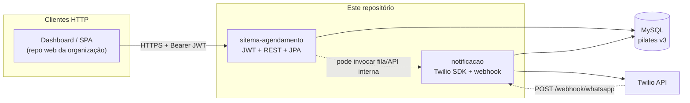

<p align="center">
  
</p>

<h1 align="center">FISASAÚDE</h1>

<p align="center">
  Sistema de <strong>agendamento automatizado de atendimentos de pilates</strong>, com foco em <strong>organização da agenda</strong>, <strong>redução de erros operacionais</strong> e <strong>melhoria da experiência do cliente</strong>.
</p>

<p align="center">
  <a href="mailto:FISASAUDE@sptech">
    
  </a>
  <a href="https://www.openstreetmap.org/relation/298285">
    
  </a>
  <a href="https://github.com/FisaSaude">
    
  </a>
</p>

<p align="center">
  <a href="https://github.com/FisaSaude/fisaSaude/tree/main/backend/sitema-agendamento">
    
  </a>
  <a href="https://github.com/FisaSaude/fisaSaude/tree/main/backend/notificacao">
    
  </a>
  <a href="https://github.com/FisaSaude/fisaSaude/tree/main/bd">
    
  </a>
</p>

Este repositório é o núcleo de **backend Java**, **notificações WhatsApp** e **modelagem do banco** do projeto FisaSaúde. Frontend, ETL e configuração corporativa **costumam** ficar em **outros repositórios** da organização no GitHub; alinhem sempre com este README antes de rodar APIs ou atualizar schema.

---

## Problema

- Esquecimento de atendimentos agendados
- Agendamentos incorretos ou conflitantes
- Falta de organização da agenda do profissional
- Interrupções durante atendimentos para novos agendamentos
- Baixa autonomia do cliente para marcar horários

## Solução

- Agendamento com regras no backend (`sitema-agendamento`)
- Interface para clientes (repositório web da disciplina/org)
- Notificações via WhatsApp (Twilio no serviço `notificacao`)
- Gestão de agenda por perfil (admin, recepção, instrutor)

## Estrutura deste monorepo

| Caminho | Função |
|--------|--------|
| `backend/sitema-agendamento/` | API REST (Spring Boot): clientes, agendamentos, usuários, **JWT/OpenAPI**, JPA/MySQL |
| `backend/notificacao/` | Envio WhatsApp via Twilio, **webhook de entrada** (`/webhook/whatsapp`) |
| `bd/pilates.sql` | Script MySQL **canônico (v3)** — fonte para ambiente integrado |
| `bd/der_v3.mwb` | DER no MySQL Workbench |
| `assets/der-v3.png` | Imagem do diagrama para onboarding rápido |
| `progWebProjetosIndividuais/` | Entregas de front/acadêmicos por sprint |

---

## Início rápido (backend)

### 1. Banco MySQL

- Suba um MySQL 8 compatível com o projeto.
- Crie o schema e cargas iniciais executando **`bd/pilates.sql`** (database `pilates`).

### 2. API `sitema-agendamento`

Variáveis de ambiente esperadas (`application.yaml`):

- `DB_HOST`, `DB_NAME`, `DB_USER`, `DB_PASSWORD`
- `JWT_SECRET` (produção: valor forte obrigatório)

No diretório do módulo:

```bash
cd backend/sitema-agendamento
./mvnw spring-boot:run
```

- Porta padrão: **8080**
- Swagger UI: **`/swagger-ui.html`**
- OpenAPI JSON: **`/v3/api-docs`**

Endpoints (exceto login e documentação OpenAPI liberados pela configuração atual) usam **autenticação JWT**: obtenha token no fluxo de login e envie `Authorization: Bearer …` nas chamadas seguintes.

### 3. Serviço `notificacao`

- Configurar credenciais Twilio (**não commitar secrets** — preferir env ou arquivo local fora do Git).
- Hoje usa H2 em memória no exemplo; para integração real com o mesmo schema pilates em MySQL, alinhar `application.properties`/profile com time.
- **`POST /webhook/whatsapp`** recebe callbacks da Twilio (form params como `Body`, `From`). Este módulo **não usa Spring Security JWT** atualmente — o webhook precisa ficar HTTP-recebível onde a Twilio alcança a URL configurada na console.

Para subir os dois backends na mesma máquina, use **portas diferentes** (ex.: `server.port` em uma das aplicações).

---

## JWT e WhatsApp/Twilio

- **JWT** protege a **API de agendamento** no `sitema-agendamento` (consumo típico: dashboard/front).
- O **SDK Twilio** no `notificacao` usa **Account SID + Auth Token** configurados na aplicação — independente do JWT.
- Chamadas HTTP **entrantes da Twilio** não carregam o JWT do seu usuário final; são tráfego servidor-a-servidor. Se no futuro o `notificacao` ganhar segurança global com JWT, será necessário **`permitAll()` (ou equivalente) em `/webhook/**`** e/ou validação de assinatura Twilio conforme especificação deles — senão callbacks quebram com 401.

---

## Modelo de dados (DER v3)

O diagrama abaixo reflete **`assets/der-v3.png`**, espelhado em **`bd/pilates.sql`**.

<p align="center">
  
</p>

### Tabelas em linguagem simples

1. **`cliente`** — Nome, **WhatsApp** (`telefone_whatsapp`), `whatsapp_ativo`, opcionais: nascimento, sexo, foto.
2. **`usuario`** — Operadores do sistema (**perfil**: admin, recepcionista, instrutor), credenciais, vínculo a estabelecimento conforme modelo.
3. **`servico`** — Tipo de serviço/aula, duração, preço.
4. **`agendamento`** — Núcleo: cliente + serviço + **usuário** (slot), **data**, **horários**, status, observações; **unique** `(data, hora_inicio, usuario_id)` evita conflito de agenda para o mesmo profissional.
5. **`notificacao`** — Envios ligados ao agendamento (tipo, status, texto, tentativas, SID Twilio, retry).
6. **`agendamento_status_historico`** — Histórico de mudanças de status.
7. **`mensagem_resposta_whatsapp`** — Respostas de clientes recebidas via canal WhatsApp/webhook.
8. **`prontuario`**, **`estabelecimento`**, **`despesas`** conforme modelo operacional/financeiro.

### Diagrama Visual x `pilates.sql`

| Possível nome no diagrama Workbench | Nome no SQL versionado aqui |
|-------------------------------------|-----------------------------|
| “auditoria” (conceito) | `agendamento_status_historico` |
| “webhook” (conceito) | `mensagem_resposta_whatsapp` |

**Status de agendamento** no schema atual: `AGENDADO`, `CANCELADO`, `CONCLUIDO`. Em caso de dúvida em tipos ENUM ou defaults, vale **`bd/pilates.sql`**.

---

## Arquitetura (visão simplificada)



### Jobs concorrentes (produção)

Se houver **várias réplicas** de um mesmo serviço com scheduler, vale coordenar com **lock** (tabela MySQL ou outro mecanismo acordado). **Redis não é obrigatório** no MVP desde que não haja execução duplicada prejudicial ao negócio.

---

## Tecnologias (referência)

<p>
  
  
  
  
  
  
  
  
  
</p>

Outros stacks podem integrar outros repositórios da organização; **neste monorepo domina Java/Spring + MySQL.**

---

## Requisitos

- JDK **21**
- Maven **3.9+** (ou `./mvnw` em cada backend)
- **MySQL 8** quando integrar ao script `pilates.sql`

---

## Equipe do projeto integrador

| Dandara Ramos | Edson Félix | Isabela Menezes | Vinicius Melo | Wendel Sousa |
|:---:|:---:|:---:|:---:|:---:|
| Front-End | Fullstack | Analista de Software | Arquiteto de Software | Back-End |
