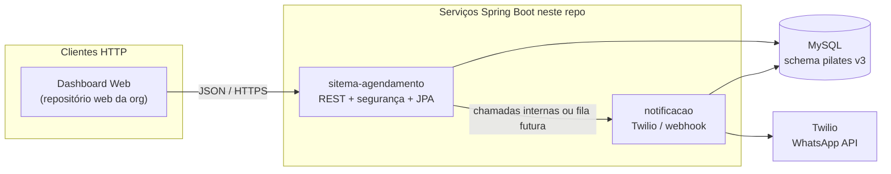

  

<h1 align="center">FISASAÚDE</h1>

  Sistema de <strong>agendamento automatizado de atendimentos de pilates</strong>, com foco em <strong>organização da agenda</strong>, <strong>redução de erros operacionais</strong> e <strong>melhoria da experiência do cliente</strong>.

  
  
  

  
  
  

  <em>Outros repositórios da organização (web, ETL, config etc.) complementam este ecossistema; aqui está o núcleo de backend, notificações e modelo de dados deste repositório.</em>

---

## Problema

- Esquecimento de atendimentos agendados
- Agendamentos incorretos ou conflitantes
- Falta de organização da agenda do profissional
- Interrupções durante atendimentos para novos agendamentos
- Baixa autonomia do cliente para marcar horários

## Solução

- Agendamento automatizado com regras no backend
- Interface simples para clientes agendarem (via aplicação web da organização)
- Painel com visão da agenda e indicadores (conforme módulos entregues)
- Notificações por WhatsApp (lembretes e confirmações) via integração dedicada
- Gestão de agenda para recepção, instrutores e administradores

## Caso de uso (FisaSaúde)

O estúdio hoje costuma depender de processos manuais ou ferramentas pouco integradas, o que gera esquecimentos, conflitos de horário e dificuldade de visão da agenda. O sistema centraliza cadastros, horários e comunicação, reduzindo retrabalho e melhorando a experiência de profissionais e clientes.

## Estrutura deste repositório

| Caminho | Função |
|--------|--------|
| `backend/sitema-agendamento/` | API principal (Spring Boot): clientes, agendamentos, usuários, segurança, OpenAPI |
| `backend/notificacao/` | Serviço de envio / webhook relacionado a WhatsApp (Twilio) |
| `bd/pilates.sql` | Script **canônico** do banco MySQL (versão **3.0**) |
| `bd/der_v3.mwb` | Modelo lógico no MySQL Workbench (DER v3) |
| `AJUSTES_DER_REDIS.md` | Notas de evolução do schema e alternativas a Redis |
| `assets/der-v3.png` | Export do diagrama para leitura direta no README |
| `progWebProjetosIndividuais/` | Projetos acadêmicos / front de apoio conforme disciplina |

## Modelo de dados (DER v3) — como ler o diagrama

O diagrama abaixo é a **mesma versão** versionada em `assets/der-v3.png` e refletida em `bd/pilates.sql` (pequenas diferenças de nomenclatura entre o desenho e o script são explicadas na tabela seguinte).

  

### Em linguagem simples

1. **`cliente`** — Quem marca a aula: nome, **número de WhatsApp** (identificador de contato), se aceita comunicação pela API (`whatsapp_ativo`), dados opcionais (nascimento, sexo, foto).
2. **`usuario`** — Quem opera o sistema (**admin**, recepcionista ou instrutor): login com e-mail/senha e **perfil** de permissão.
3. **`servico`** — O que será agendado (tipo de aula/serviço, duração, preço).
4. **`agendamento`** — **Centro do modelo**: une um cliente, um serviço e um **usuário** (quem ministra ou responde por aquele slot), com **data**, **hora início/fim**, **status** e observações. A regra de não duplicar o mesmo instrutor no mesmo horário aparece como restrição única no SQL.
5. **`notificacao`** — Mensagens disparadas sobre um agendamento (tipo, status de envio, texto, tentativas, identificador Twilio para rastrear reenvios e webhooks).
6. **`agendamento_status_historico`** — Auditoria de mudanças de status (quem alterou e quando — no diagrama visual pode aparecer com outro nome, ex.: “auditoria”).
7. **`mensagem_resposta_whatsapp`** — Respostas do cliente vindas do canal WhatsApp/webhook (no diagrama pode aparecer como “webhook”).
8. **`prontuario`** — Observações clínicas/operacionais ligadas ao cliente e, opcionalmente, a um agendamento.
9. **`estabelecimento`** — Dados do estúdio e janela de funcionamento.
10. **`despesas`** — Registros financeiros associados ao estabelecimento.

### Nomes no diagrama x nomes no `pilates.sql`

| No desenho (Workbench) | No script SQL / documentação |
|------------------------|-------------------------------|
| Tabela tipo “auditoria” | `agendamento_status_historico` |
| Tabela tipo “webhook” | `mensagem_resposta_whatsapp` |
| Tipos de domínio (ex.: blob em campo booleano no desenho) | No SQL usamos tipos adequados (`BOOLEAN`, `DATETIME`) — fonte da verdade: `pilates.sql` |

Status de agendamento no banco atual: **`AGENDADO`**, **`CANCELADO`**, **`CONCLUIDO`**.

## Arquitetura do sistema — visão técnica

Fluxo típico: a **interface web** (mantida nos repositórios de frontend da organização) chama a **API de agendamento**; esta persiste em **MySQL** e pode acionar o **serviço de notificação**, que conversa com a **Twilio** para WhatsApp e grava registros relacionados no mesmo banco.

### Responsabilidades resumidas

| Componente | Papel |
|------------|------|
| `sitema-agendamento` | CRUD de negócio, autenticação, regras de agenda, Swagger/OpenAPI |
| `notificacao` | Envio e recebimento de mensagens WhatsApp (integração Twilio), registro auxiliar quando aplicável |
| MySQL (`pilates.sql`) | Consistência, índices, views de KPI, constraints (ex.: unicidade por data/hora/usuário) |

Detalhes de lock distribuído e alternativa ao Redis estão em `AJUSTES_DER_REDIS.md`.

## Tecnologias

  
  &nbsp;
  
  &nbsp;
  
  &nbsp;
  
  &nbsp;
  
  &nbsp;
  
  &nbsp;
  
  &nbsp;
  
  &nbsp;
  

*Python e outros stacks podem aparecer em repositórios irmãos da organização (ETL, automação). Neste monorepo o backend é predominantemente Java/Spring.*

## Requisitos para desenvolvimento local (módulos Java)

- **JDK** 21
- **Maven** 3.9+
- **MySQL** 8.x (criar schema executando `bd/pilates.sql` ou aplicar migrações equivalentes)

Cada projeto em `backend/*/ ` possui seu próprio `pom.xml` e pode ser compilado com `./mvnw` (wrapper) onde disponível.

## Organização GitHub (repositórios adicionais)

Além deste monorepo, a organização costuma dividir trabalhos em outros repositórios (referência institucional): banco isolado, aplicação web, processamento, configuração, projetos individuais etc. Este README cobre sobretudo **o que vive dentro de `FisaSaude/fisaSaude`.**

---

## Equipe

| Dandara Ramos | Edson Félix | Isabela Menezes | Vinicius Melo | Wendel Sousa |
|:---:|:---:|:---:|:---:|:---:|
| Front-End | Fullstack | Analista de Software | Arquiteto de Software | Back-End |
