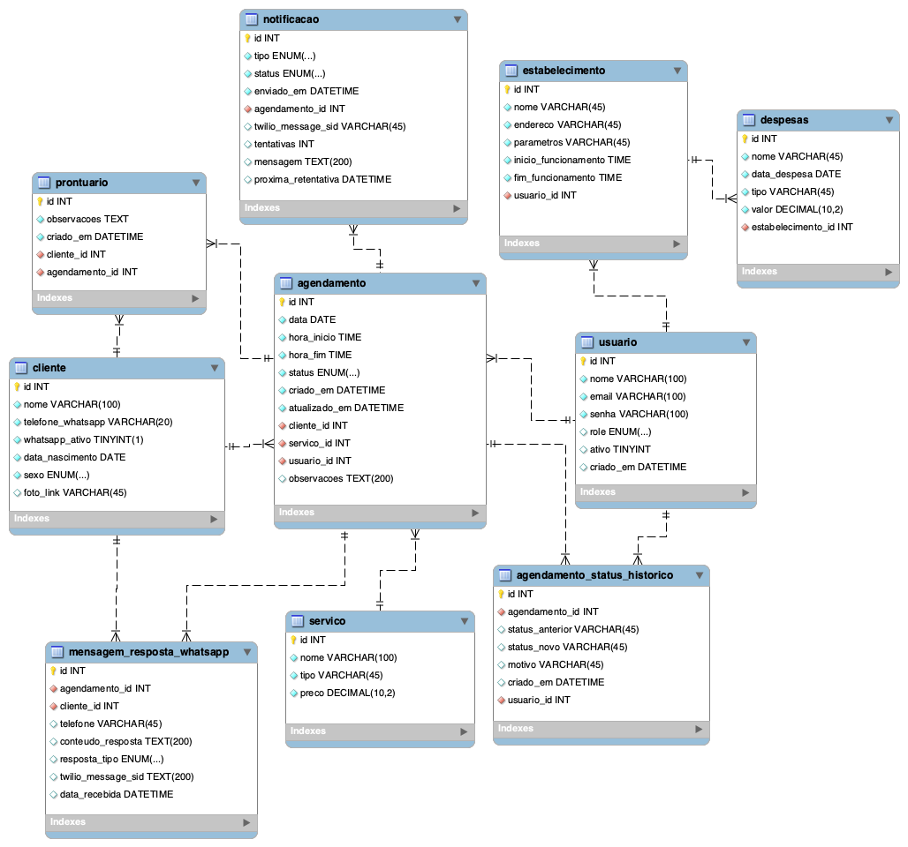
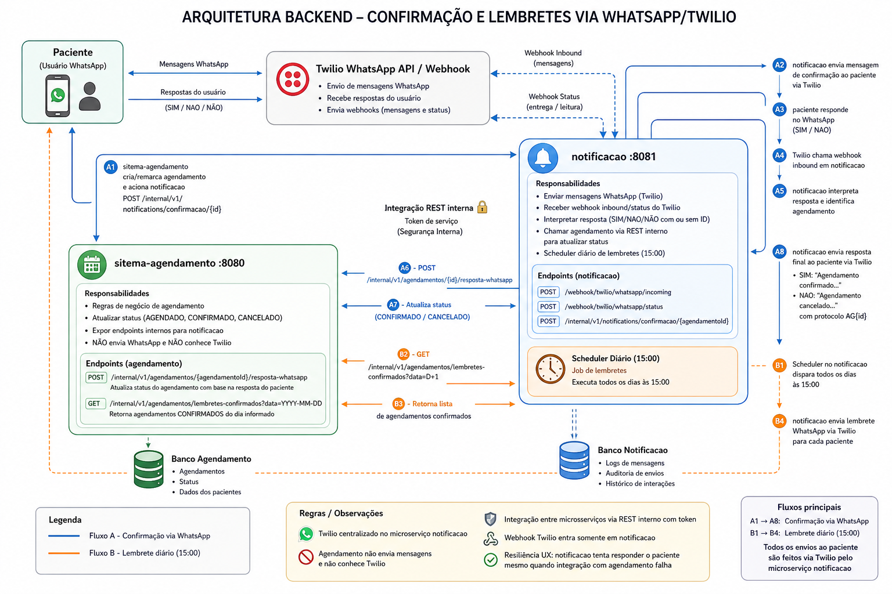

<p align="center">
  
</p>

<h1 align="center">FISASAÚDE</h1>

<p align="center">
  Sistema de <strong>agendamento automatizado de atendimentos de pilates</strong>, com foco em <strong>organização da agenda</strong>, <strong>redução de erros operacionais</strong> e <strong>melhoria da experiência do cliente</strong>.
</p>

<p align="center">
  <a href="mailto:FISASAUDE@sptech">
    
  </a>
  <a href="https://www.openstreetmap.org/relation/298285">
    
  </a>
  <a href="https://github.com/FisaSaude">
    
  </a>
</p>

<p align="center">
  <a href="https://github.com/FisaSaude/fisaSaude/tree/main/backend/sitema-agendamento">
    
  </a>
  <a href="https://github.com/FisaSaude/fisaSaude/tree/main/backend/notificacao">
    
  </a>
  <a href="https://github.com/FisaSaude/fisaSaude/tree/main/bd">
    
  </a>
</p>

Este repositório é o núcleo de **backend Java**, **notificações WhatsApp** e **modelagem do banco** do projeto FisaSaúde. Frontend, ETL e configuração corporativa **costumam** ficar em **outros repositórios** da organização no GitHub; alinhem sempre com este README antes de rodar APIs ou atualizar schema.

---

## Problema

- Esquecimento de atendimentos agendados
- Agendamentos incorretos ou conflitantes
- Falta de organização da agenda do profissional
- Interrupções durante atendimentos para novos agendamentos
- Baixa autonomia do cliente para marcar horários

## Solução

- Agendamento com regras no backend (`sitema-agendamento`)
- Interface para clientes (repositório web da disciplina/org)
- Notificações via WhatsApp (Twilio no serviço `notificacao`)
- Gestão de agenda por perfil (admin, recepção, instrutor)

## Estrutura deste monorepo

| Caminho | Função |
|--------|--------|
| `backend/sitema-agendamento/` | API REST (Spring Boot, **:8080**): clientes, agendamentos, usuários, **JWT/OpenAPI**, JPA/MySQL |
| `backend/notificacao/` | Envio WhatsApp via Twilio, webhooks e rotas internas (**:8081**), mesmo MySQL `pilates` |
| `bd/pilates.sql` | **Único script** de banco: `DROP` + `CREATE` + seeds (instalação do zero, sem `ALTER`) |
| `bd/apply-pilates.sh` | Atalho: `DB_PASSWORD=… ./bd/apply-pilates.sh` |
| `backend/docs/api/bruno/FisaSaude/` | Collection Bruno unificada (8080 + 8081) |
| `bd/der_v3.mwb` | DER conceitual no MySQL Workbench (pode divergir do SQL versionado) |
| `assets/der-v3.png` | Imagem do diagrama para onboarding rápido |
| `progWebProjetosIndividuais/` | Entregas de front/acadêmicos por sprint |

---

## Início rápido (backend)

### 1. Banco MySQL

- Suba um **MySQL 8** compatível com o projeto.
- O schema **não** é mais criado por `schema.sql` / `data.sql` dentro dos módulos Spring (`spring.sql.init.mode: never`).
- Fonte única versionada: **`bd/pilates.sql`** (database `pilates`).

```bash
export DB_PASSWORD='sua_senha'
./bd/apply-pilates.sh
# ou: mysql -u root -p < bd/pilates.sql
```

Isso recria o banco do zero (apaga dados anteriores em `pilates`) e aplica tabelas + dados de desenvolvimento.

### 2. API `sitema-agendamento`

Variáveis de ambiente esperadas (`application.yaml`):

- `DB_HOST`, `DB_NAME`, `DB_USER`, `DB_PASSWORD`
- `JWT_SECRET` (produção: valor forte obrigatório)

No diretório do módulo:

```bash
cd backend/sitema-agendamento
./mvnw spring-boot:run
```

- Porta padrão: **8080**
- Swagger UI: **`/swagger-ui.html`**
- OpenAPI JSON: **`/v3/api-docs`**

Endpoints (exceto login e documentação OpenAPI liberados pela configuração atual) usam **autenticação JWT**: obtenha token no fluxo de login e envie `Authorization: Bearer …` nas chamadas seguintes.

### 3. Serviço `notificacao`

Variáveis de ambiente (mesmo MySQL `pilates` que o agendamento):

- `DB_HOST`, `DB_NAME`, `DB_USER`, `DB_PASSWORD`
- Credenciais Twilio: `TWILIO_ENABLED`, `TWILIO_ACCOUNT_SID`, `TWILIO_AUTH_TOKEN`, etc. (**não commitar secrets**)

```bash
cd backend/notificacao
./mvnw spring-boot:run
```

- Porta padrão: **8081**
- Webhooks Twilio: `POST /webhook/twilio/whatsapp/incoming` e `POST /webhook/twilio/whatsapp/status`
- Rotas internas (token `X-Internal-Token`, padrão dev `dev123`): `/internal/v1/notifications/…`
- Lembrete D-1: scheduler às **15h** + disparo manual `POST /internal/v1/notifications/lembretes/disparar`

Este módulo **não usa JWT** no fluxo do paciente; webhooks precisam ser alcançáveis pela Twilio.

### 4. Bruno (testes de API)

Abra a collection em **`backend/docs/api/bruno/FisaSaude`** (pasta que contém `bruno.json`).

| Pasta na collection | Serviço | Ambiente Bruno |
|---------------------|---------|----------------|
| `01-sistema-agendamento` | `:8080` | `local` |
| `02-notificacao` | `:8081` | `notificacao` |

Para subir os dois backends na mesma máquina, use **8080** e **8081** (já é o padrão nos `application.yaml`).

---

## JWT e WhatsApp/Twilio

- **JWT** protege a **API de agendamento** no `sitema-agendamento` (consumo típico: dashboard/front).
- O **SDK Twilio** no `notificacao` usa **Account SID + Auth Token** configurados na aplicação — independente do JWT.
- Chamadas HTTP **entrantes da Twilio** não carregam o JWT do seu usuário final; são tráfego servidor-a-servidor. Se no futuro o `notificacao` ganhar segurança global com JWT, será necessário **`permitAll()` (ou equivalente) em `/webhook/**`** e/ou validação de assinatura Twilio conforme especificação deles — senão callbacks quebram com 401.

---

## Modelo de dados

O diagrama em **`assets/der-v3.png`** / **`bd/der_v3.mwb`** é referência conceitual. O que as APIs Spring validam hoje é **`bd/pilates.sql`** (9 tabelas usadas por JPA).

<p align="center">
  
</p>

### Tabelas no `bd/pilates.sql` (runtime)

| Tabela | Uso |
|--------|-----|
| `estabelecimento` | Unidade, horário de funcionamento |
| `usuario` | Login (`ADMIN` / `USUARIO`), vínculo ao estabelecimento |
| `cliente` | Paciente + `telefone_whatsapp` |
| `servico` | Tipo de aula, duração, preço |
| `agendamento` | Agenda (`cliente`/`servico` opcionais para bloqueio de dia); status `AGENDADO`, `CONFIRMADO`, `CANCELADO`, `CONCLUIDO`, `BLOQUEADO` |
| `notificacao` | Fila de envio (confirmação, lembrete, etc.) |
| `mensagem_resposta_whatsapp` | Respostas SIM/NÃO recebidas via webhook |
| `prontuario` | Observações clínicas por cliente |
| `despesa` | Lançamentos financeiros (`tipo` como `VARCHAR`) |

### O que saiu do script antigo (e por quê)

No `pilates.sql` v3 anterior existiam também:

- **`agendamento_status_historico`** — auditoria de cada mudança de status. **Não há** `@Entity`, repository nem endpoint nos microserviços; o status atual fica só em `agendamento.status`. Incluir a tabela faria o Hibernate falhar em `ddl-auto: validate` ou exigiria código morto. Quando o time implementar auditoria, volta ao script + JPA.
- **Views KPI** (`kpi_aulas_dia`, `kpi_aulas_mes`, etc.) — relatórios SQL no Workbench, **não** usadas pelo backend. Podem ser recriadas em migration/BI depois, fora do script de bootstrap.

**Regra:** o script consolidado contém apenas o que os dois serviços **leem e gravam** hoje.

**Status de agendamento** e demais ENUMs: conferir sempre **`bd/pilates.sql`** (fonte da verdade para dev/CI).

---

## Arquitetura (confirmação e lembretes via WhatsApp)

<p align="center">
  
</p>

### Sequência completa (explicação direta)

#### Quem faz o quê

- `sitema-agendamento` (`:8080`): atualiza status e aplica regra de negócio de agendamento.
- `notificacao` (`:8081`): envia WhatsApp, recebe webhook da Twilio e orquestra confirmação/lembretes.
- Twilio: entrega mensagens ao paciente e chama webhook inbound/status no `notificacao`.

#### Fluxo A - Confirmação do paciente

1. `sitema-agendamento` cria/remarca e chama:
   - `POST /internal/v1/notifications/confirmacao/{agendamentoId}`
2. `notificacao` envia mensagem de confirmação via Twilio.
3. Paciente responde no WhatsApp (`SIM`/`NAO`, com ou sem ID).
4. Twilio chama:
   - `POST /webhook/twilio/whatsapp/incoming`
5. `notificacao` identifica cliente/agendamento e chama:
   - `POST /internal/v1/agendamentos/{agendamentoId}/resposta-whatsapp`
6. `sitema-agendamento` atualiza status:
   - `SIM` -> `CONFIRMADO`
   - `NAO` -> `CANCELADO`
7. `notificacao` envia retorno final ao paciente via Twilio (com protocolo `AG{id}`).

#### Fluxo B - Lembrete diário (15:00)

1. Scheduler no `notificacao` (cron `0 0 15 * * ?`, fuso `America/Sao_Paulo`) ou disparo manual:
   - `POST /internal/v1/notifications/lembretes/disparar?data=YYYY-MM-DD`
2. `notificacao` consulta o `sitema-agendamento`:
   - `GET /internal/v1/agendamentos/lembretes-confirmados?data=YYYY-MM-DD`
3. `sitema-agendamento` retorna agendamentos `CONFIRMADOS` na data informada (D+1 na rotina automática).
4. `notificacao` envia lembretes via Twilio para cada paciente.

#### Pontos críticos de operação

- Twilio fica centralizado no `notificacao`.
- `sitema-agendamento` não envia mensagem e não conhece Twilio.
- Integração entre microsserviços é REST interno com token.
- Webhook Twilio entra somente no `notificacao`.
- Mesmo com falha na integração com `agendamento`, o `notificacao` prioriza responder o paciente (UX primeiro).

---

## Tecnologias (referência)

<p>
  
  
  
  
  
  
  
  
  
</p>

Outros stacks podem integrar outros repositórios da organização; **neste monorepo domina Java/Spring + MySQL.**

---

## Requisitos

- JDK **21**
- Maven **3.9+** (ou `./mvnw` em cada backend)
- **MySQL 8** quando integrar ao script `pilates.sql`

---

## Equipe do projeto integrador

| Dandara Ramos | Edson Félix | Isabela Menezes | Vinicius Melo | Wendel Sousa |
|:---:|:---:|:---:|:---:|:---:|
| Front-End | Fullstack | Analista de Software | Arquiteto de Software | Back-End |
